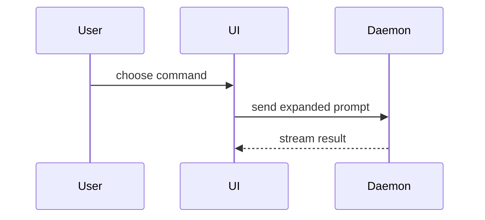

## Where the body goes

A land opens or updates the record PR of its branch, and the PR's title and body come from the record file (`land` → The record file names its path, its title line, and what goes in each section). This skill is the format of that body. `land` refuses a record that lacks one of its sections, so keep every heading, in this order:

```markdown
# <title of the PR>

## Summary

<one or more visuals, each next to one or two sentences>

Closes #<n>

## Testing

- **Before:** <the failing test, the old output, or the screenshot>
  **After:** <the passing test, the new output, or the screenshot>

## Risk

**Door:** <one-way or two-way>

**Blast radius:** <what breaks for which users if the change is wrong>

## How to revert

<the commits or steps that undo it>

## Review

<finding lines of each review round, with their outcomes>

## Open points

- [ ] <one item for each open point>

## e2e

<the e2e files that ran, and their result>
```

Write the title as a Conventional Commits subject, `<type>(<scope>): <description>`, such as `fix(annotations): keep the excerpt image size`. A default land uses this title and the full record body as the squash commit message. Keep the prose short. Use the domain terms of the `GLOSSARY.md` of the package the change is in. The repository is public: write paths relative to the repository, and no local absolute paths or scratch log locations.

## Summary

Show the change; do not describe the diff in prose. Pick the smallest view that makes the key point clear.

- Show logic or an algorithm as pseudocode:

```text
on(save)
  if content is unchanged
    return cached result
  write new content
  return fresh result
```

- Show runtime control flow as a call tree:

```text
submitForm
  createSession
    persistPrompt
    launchAgent
  navigateToSession
```

- Show UI structure as a component tree, with the state and module boundaries that matter:

```text
<SessionPage> (apps/example/src/routes/session.tsx)
  useSessionEvents()
  <SessionToolbar>
    <RunSkillButton> (packages/ui)
```

- Show file responsibility or a broad refactor as a shallow file tree:

```text
src/
├── commands/       # parses user actions
├── sessions/       # owns session state
└── transport/      # sends API requests
```

- Show component interaction, control flow, or data flow with Mermaid, which GitHub renders:



- Use `diff` when the point is what changes and the surrounding shape already exists. Match the diff shape to the topic.

For a component change:

```diff
 <SessionPage>
   useSessionEvents()
   <SessionToolbar>
+    <RunSkillButton />
   <SessionTimeline>
+    <SkillResultCard />
```

For a file-layout change:

```diff
 src/
 ├── commands/
+│   └── show-me.ts       # expands the slash command
 ├── sessions/
-└── transport.ts
+└── transport/
+    ├── client.ts
+    └── stream.ts
```

For a call-tree change:

```diff
 submitForm
   createSession
     persistPrompt
+    expandSkillMention
     launchAgent
-  navigateToSession
+  navigateToSession
+    subscribeToEvents
```

For a state or control-flow change:

```diff
 on(save)
-  write content
+  if content is unchanged
+    return cached result
+  write new content
+  invalidate cache
```

- Show the whole block when most of it is new, when omitted context would hide ownership or order, or when the reader needs a copyable target shape:

```ts
function expandSkill(command: string): string {
  const skillName = command.slice(1);
  return `use the ${skillName} skill`;
}
```

Place each visual next to the short text it supports. Keep only the calls, files, props, states, and boundaries that the maintainer needs to judge the change. Use one view, sometimes several, rarely all of them.

Put `Closes #<n>` for each ticket of the change at the end of the Summary.

## Testing

Concrete evidence that the change works, as a before and after. "The tests pass" alone is not evidence.

- A screenshot is the strongest evidence, when the change is visual and the environment can take one (`docs-screenshot`, `obsidian-debug`).
- Otherwise use evidence from a run: name the exact test that failed before the change and passes after it, as pseudocode, or show the console output that changed.

Then list the suites and commands that ran, with their results.

## Risk and How to revert

State whether the change is a one-way or a two-way door. A two-way door is cheap to walk back: a revert restores the old behavior. A one-way door is not: a destructive migration, a change to the files in a user's vault, a public API removed, a published release, or another decision that is hard to reverse.

The blast radius is what breaks, and for whom, if the change is wrong: the users of one setting, every vault at startup, the consumers of a package, layout on mobile. Consider all of them.

For a squash land, identify the commit to revert as the merged record PR head. Its SHA exists after the record is written. For a land that preserves commits, identify the landed changes to revert. Give the recovery steps for a one-way door.
